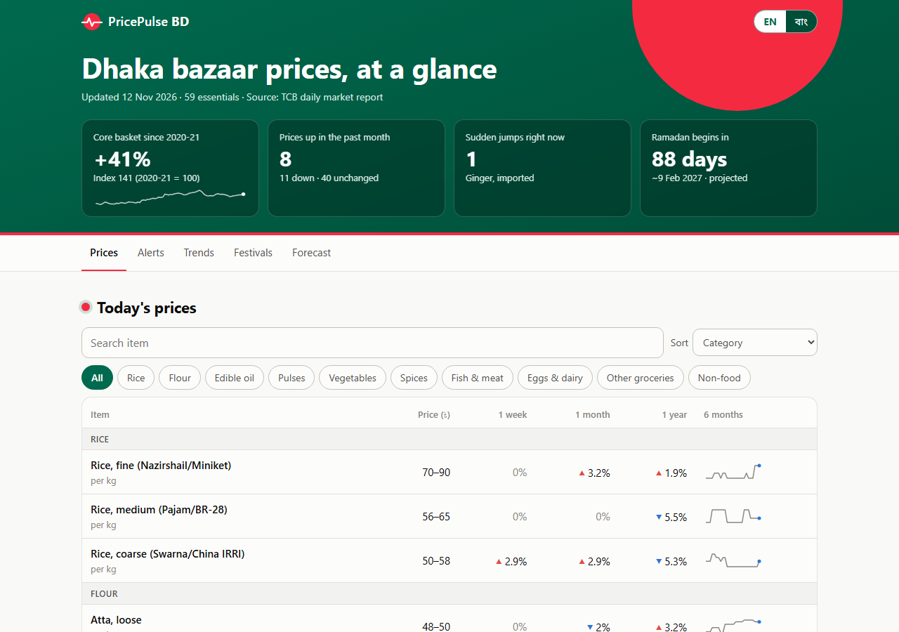
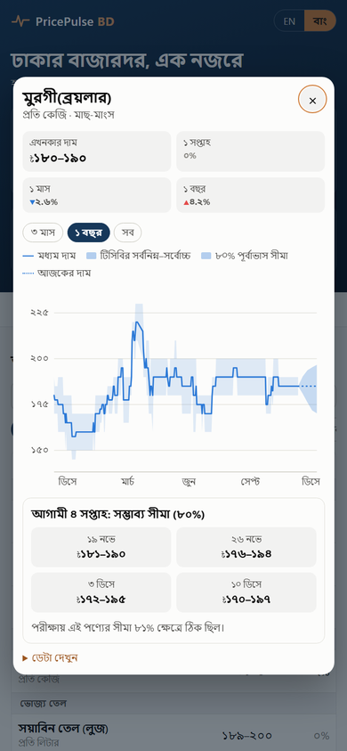
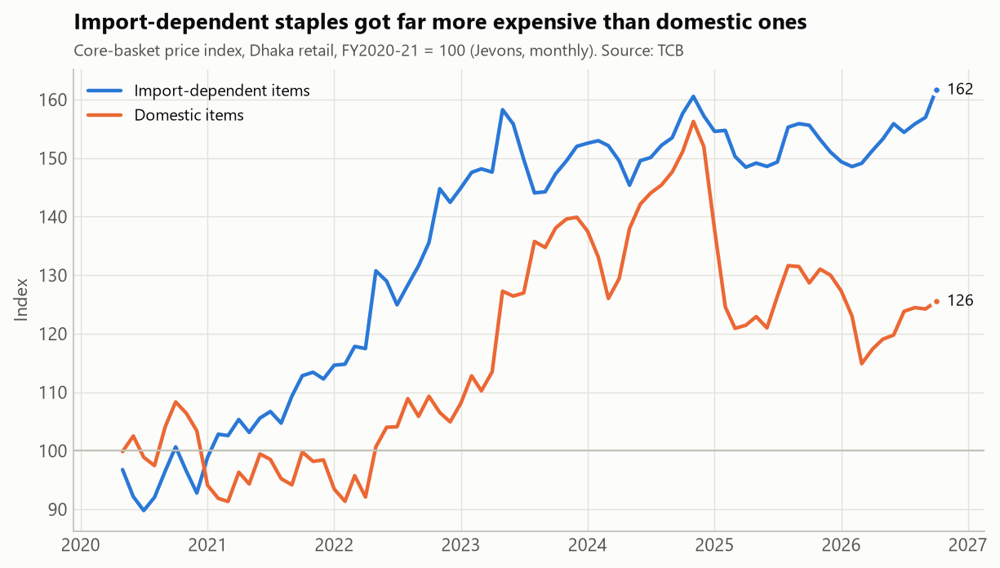
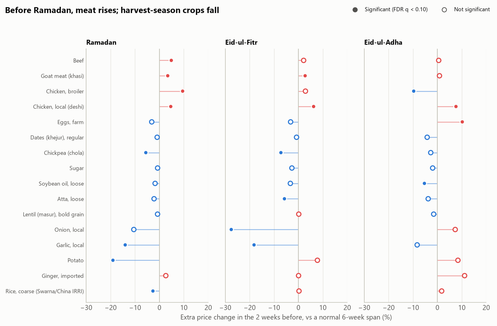
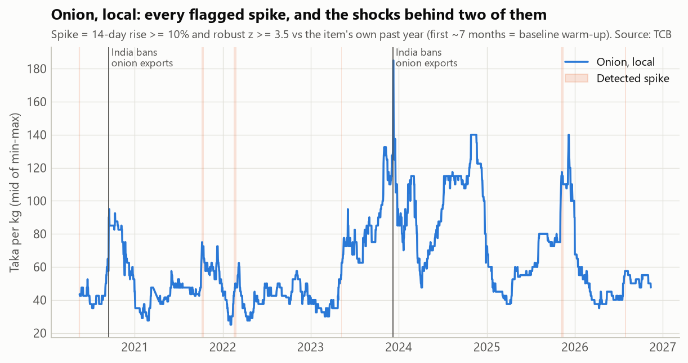
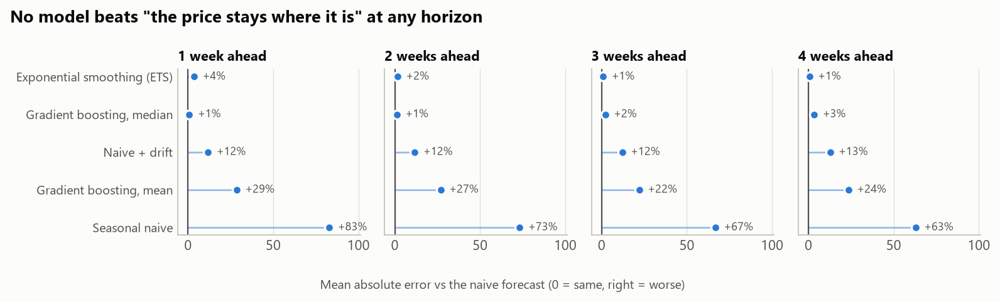

# PricePulse BD

**Essential-commodity price intelligence for Bangladesh:** daily Dhaka retail prices for
61 commodities since 2020, with spike detection, Ramadan/Eid effects and short-term
forecasts with uncertainty bands.

**Live site: [pricepulsebd.vercel.app](https://pricepulsebd.vercel.app)** · English / বাংলা · refreshed daily

> Status: **all 4 stages complete** — data pipeline, analysis, forecasting, website.

<p>


</p>

## Key findings (May 2020 – Nov 2026)



| # | Question | Answer | Method |
|---|---|---|---|
| 1 | What got expensive? | Import-dependent essentials rose a median **+71%** since FY2020-21 vs **+39%** for domestic ones; rice only +14–31% | Jevons index; permutation test p ≈ 0.002 |
| 2 | Is the scraped data right? | Tracks WFP's independent survey, level r = **0.85–0.97** | 9 overlapping commodities |
| 3 | When do prices spike? | Detector catches **6/6** documented shocks (India wheat & onion bans, Indonesia palm ban) within 0–5 days | robust z of 14-day change vs own past year |
| 4 | Do festivals move prices? | Ramadan premium sits in **meat** (beef +4.9%, broiler +9.5%), not iftar staples (sugar flat, chickpea cheaper); broiler **falls ~10%** before Eid-ul-Adha | event study vs placebo dates, BH-FDR |
| 5 | Which prices move together? | Families: rice grades, edible oils, imported staples; imported onion does **not** lead local | clustered correlation, Granger tests |

| 6 | Can next month's price be forecast? | **The level, no; the uncertainty, yes.** No model beat "price stays the same" over 39,652 out-of-sample forecasts. ML ranges are calibrated (80% coverage) and beat historical quantiles at every horizon (p < 0.05) | rolling-origin backtest, Diebold–Mariano, conformal intervals |

Walk-throughs with caveats: [`notebooks/02_analysis.ipynb`](notebooks/02_analysis.ipynb) ·
[`notebooks/03_forecasting.ipynb`](notebooks/03_forecasting.ipynb) · [`MODEL_CARD.md`](MODEL_CARD.md)

<p>


</p>

## Data

| Source | Coverage | Granularity | Notes |
|---|---|---|---|
| [TCB daily retail market price](https://tcb.gov.bd/pages/daily-rmps) | Dhaka, May 2020 – today | daily, min/max | Bangla Excel sheet per working day, scraped |
| [WFP food prices for Bangladesh](https://data.humdata.org/dataset/wfp-food-prices-for-bangladesh) (HDX, CC BY-IGO) | 124 markets, 2004 – 2026 | monthly | district-level view |

### Clean dataset — `data/processed/tcb_daily.csv`

| column | meaning |
|---|---|
| `date`, `commodity_id` | see `data/reference/commodities.csv` for English/Bangla names, unit, category |
| `price_min`, `price_max`, `price_mid` | Taka, per the unit in `commodities.csv` |
| `source` | `report` (that day's sheet) or `backfill_week/month/year` (see below) |

105k rows · 61 commodities · 2020-05-17 → today.

## What it took to get clean data

TCB's archive looks tidy but isn't. Findings from auditing all 1,435 published files:

1. **36 days link to the wrong file.** Every entry from 29 Jan – 8 Mar 2025 (the run-up to
   Ramadan) points to a 2022 comparison sheet; one more file is zero-filled at source.
2. **Gaps recovered from the sheets themselves.** Each report also lists prices 1 week,
   1 month and 1 year earlier. Those lagged values match the original report
   **99.6–99.8%** of the time, so they are used to backfill missing days (closest lag
   wins, every value keeps its `source`). This recovers the whole Ramadan-2025 gap,
   most of 2022 (only 64 reports archived) and adds a year of history (2020).
3. **One product, many labels.** e.g. local garlic appears under 8 spellings over 5 years
   (`রসুন(দেশী) নতুন/পুরাতন)`, …). Variants were verified never to co-occur on the
   same report, then mapped in `data/reference/tcb_item_map.csv`.
4. **Unicode.** `য়`/`ড়` arrive both precomposed and as base + nukta; text is NFC-normalized
   before matching.
5. **Layout drift.** The header row moves, and repeats mid-sheet right before sugar, eggs,
   dates and salt — a naive parser silently drops those (the first version did).
6. **Data-entry typos** (cumin ৳4000 instead of ৳400, rod ৳705,000 instead of ৳70,500,
   swapped min/max) are corrected by explicit rules and logged in
   `data/reference/cleaning_log.csv`. Genuine shocks (Sep 2020 onion export ban) are kept.

Full metrics: `data/reference/quality_report.json`.

## Pipeline

```
pipeline/
  scrape_tcb.py     crawl listing → manifest → download new Excel files (incremental)
  parse_tcb.py      Excel → tidy observations, partitioned by month (incremental)
  make_item_map.py  one-off bootstrap of the label → commodity mapping (CSV is the truth)
  build_dataset.py  map, validate, backfill, clean → tcb_daily.csv + quality report
  fetch_wfp.py      WFP district prices from HDX
  run_all.py        everything above, in order
```

```bash
pip install -r requirements.txt
python pipeline/run_all.py          # daily update (~1 request to TCB when nothing is new)
python pipeline/scrape_tcb.py --full && python pipeline/parse_tcb.py --full   # rebuild from scratch
```

`tcb.gov.bd` serves an incomplete TLS chain; instead of disabling verification the
pipeline ships Sectigo's public intermediate (`pipeline/certs/`).

## Analysis

```
analysis/
  data.py          loaders, daily/weekly/monthly panels, import vs domestic grouping
  eda.py           Jevons basket index, per-item inflation, import-vs-domestic test
  validate_wfp.py  TCB vs WFP (independent survey) agreement
  spikes.py        robust spike detector + recall check on known_shocks.csv
  events.py        Ramadan / Eid event study, placebo permutation test, BH-FDR
  comovement.py    clustered correlation, imported -> local lead-lag (Granger)
  figures.py       all charts (validated colour-blind-safe palette)
  run.py           everything -> outputs/*.csv|json (site payloads) + reports/figures
```

```bash
python -m analysis.run                   # ~2 min (festival permutation tests)
python notebooks/build_02_analysis.py    # regenerate + execute the notebook
```

Festival dates (`data/reference/festivals.csv`) are Bangladesh's moon-sighting dates,
which often differ by a day from Saudi Arabia's. 2027 dates are astronomical
projections (±1 day), used only as forecast features.

## Forecasting



Six models were compared on 1–4 week horizons with a rolling-origin backtest
(Feb 2023 – Nov 2026, 57 commodities). **None beat "the price stays where it is"** —
retail prices here don't move in 63% of weeks, and when they do the change is
unpredictable from history. Machine learning earns its place on the *range* instead:

| 80% range method | Coverage, 1 → 4 weeks | Verdict |
|---|---|---|
| Item's own past changes | 85.5 → 81.7% | too wide early |
| ML quantiles, raw | 80.1 → 74.5% | overconfident |
| **ML + conformal correction (shipped)** | **79–81% at every horizon** | calibrated, best interval score |

So the product ships **today's price + an ML-built 80% range**, and publishes each
item's own backtest coverage beside it. Shipping rules were fixed in code before the
results were read; a look-ahead test guards every feature.

```
forecast/
  panel.py      weekly (Thursday) panel, 25 features known at the forecast day
  models.py     naive, drift, seasonal naive, ETS, pooled gradient boosting (mean/median/quantile)
  backtest.py   rolling origin, Diebold-Mariano, interval score, conformal calibration
  run.py        backtest -> selection rules -> outputs/forecasts.json + figures
tests/test_no_leakage.py   features must not change when the future is deleted
```

```bash
python -m forecast.run                      # ~8 min
python tests/test_no_leakage.py
python notebooks/build_03_forecasting.py
```

## Website

A static page (`site/`: plain HTML, CSS and JavaScript, no framework, no build step)
that reads two kinds of JSON written by `python -m analysis.site`:

* `site/data/app.json` (~50 KB): today's prices, changes, spike alerts, basket index,
  festival effects, forecasts and their backtest scores
* `site/data/series/<item>.json`: full daily history, fetched when an item is opened

Features:

* **Price table**: search, category filter, sort, 6-month sparklines, spike badges
* **My bazaar**: edit a family's monthly basket and see this month's bill, the change
  vs a month and a year ago, where the money goes, and which items drove the change
  (saved in the visitor's browser only)
* **Compare items**: up to 4 items on one indexed chart (start = 100), 1 y / 3 y / since 2020-21
* **When prices move**: heatmap of month-on-month changes for the 20 core items
* **Item view**: min–max band, 4-week 80% range with that item's own backtest
  coverage, and "a typical year" (seasonal profile: ratio to a centred 13-month
  average, by calendar month, shown only with ≥ 3 years per month); shareable link
* **Spike alerts**, **import vs domestic index**, **festival effects** with a
  clickable average price path around Ramadan / Eid (range across years shaded),
  and the **forecast honesty panel**

Bangla/English, dark mode, keyboard-accessible charts with data-table views,
colour-blind-safe palette (validated), 390 px mobile layout. Shareable links:
`?lang=bn`, `?item=onion_local`.

**Daily refresh** (`.github/workflows/daily.yml`, 19:30 Dhaka time): scrape TCB →
rebuild dataset → if prices changed: re-run analysis, re-run the forecast when a new
Thursday is in (with the look-ahead test first), rebuild site data, commit, and deploy
to Vercel. Days without a new TCB sheet cost one request and no deployment.

## Roadmap

- [x] **1. Data** — scraper, parser, label mapping, validation, backfill, cleaning
- [x] **2. Analysis** — EDA, spike detection, Ramadan/Eid event study, co-movement
- [x] **3. Models** — seasonal-naive / ETS / gradient boosting, rolling-origin backtests, prediction intervals
- [x] **4. Product** — static site on Vercel (Bangla/English), daily GitHub Action refresh, model card

---
Built by Atiqul Islam Chowdhury · Data: TCB (Government of Bangladesh), WFP via HDX
